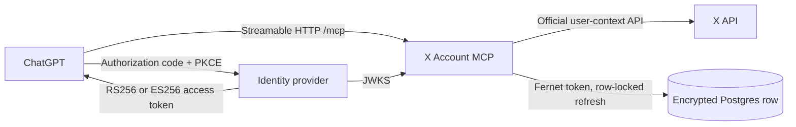

<p align="center">
  
</p>

# X Account MCP

A production [MCP](https://modelcontextprotocol.io) server for one X account. ChatGPT is connected to it.

The agent can read the account, publish and edit posts, upload images, and draft or publish native long-form Articles. It never sees the X credentials. The X API never receives an action this server did not construct on purpose: a real edit, a checked delete, or an Article that was drafted before it was published.

Local clients use stdio. Remote clients use Streamable HTTP on an OAuth resource server that admits a single owner. Posts and Articles go through X API v2. Profile edits use the legacy v1.1 account endpoints. Authentication is OAuth. The server stores no passwords and does not scrape a browser session.

## What ChatGPT actually calls

<p align="center">
  
</p>

The public service is live. ChatGPT completes OAuth against the identity provider, then calls the MCP endpoint. This process is the resource server. Login, dynamic client registration, consent, and refresh tokens belong to the provider. A valid login as anyone else still fails here.



Every accepted token is RS256 or ES256 and must match the configured issuer, audience, expiry, owner `sub`, scope, and a `client_id` or `azp`. The JWKS URL comes from configuration, never from the token. `/health` returns `{"status":"ok"}` and nothing else. Anonymous calls to `/mcp` get a 401 and the protected-resource metadata.

X OAuth 2 tokens are a different system from the chatbot login. They live in one Postgres row, encrypted with Fernet. When the access token is inside a minute of expiry, the worker locks that row, refreshes at X, and commits the rotated refresh token before any other worker can reuse the old one. The host can sleep. The login survives the restart. Losing the encryption key means signing in again. A crash between X's refresh and the commit can mean the same thing, and the server says so.

The deployment recipe is [DEPLOYMENT.md](DEPLOYMENT.md).

## Pictures the tools can carry

`upload_image` takes a PNG or JPEG as raw base64. It checks the file signature and this server's 5 MiB cap, then hands the bytes to X. A tool argument cannot point at a local path or an arbitrary URL.

<table>
  <tr>
    <td width="50%" align="center"></td>
    <td width="50%" align="center"></td>
  </tr>
  <tr>
    <td align="center">A post image. The monitor text is part of the picture. The tool sends the bytes.</td>
    <td align="center">An Article is a draft first. A cover is an uploaded media id. Publish is a separate call and returns a different post id.</td>
  </tr>
</table>

## The boundary

| Tool | What it does |
| --- | --- |
| `get_account` | Read the authenticated profile, username, ID, and public metrics |
| `get_post` | Read a post, including edit metadata and Article fields when X returns them |
| `list_my_posts` | Read one page of your posts. Pass `meta.next_token` back as `pagination_token` |
| `upload_image` | Upload PNG or JPEG as raw base64. Returns a media ID. Requires `media.write` |
| `create_post` | Publish text, a reply, a quote, or up to four already-uploaded media IDs |
| `update_post` | Edit your own eligible post with `edit_options.previous_post_id`. Returns the new post ID |
| `delete_post` | Permanently delete your own post |
| `preview_article` | Build the Article payload locally. No credentials. No network |
| `create_article_draft` | Create an unpublished native Article. Optional cover is an uploaded image |
| `publish_article` | Publish that Article ID. Returns the public post ID and link |
| `update_profile` | Change display name, bio, location, or website. Omitted fields stay as they are |
| `update_profile_image` | Replace the avatar with base64 PNG, JPEG, or GIF |
| `update_profile_banner` | Replace the banner with base64 PNG, JPEG, or GIF |
| `remove_profile_banner` | Remove the banner |

`x-account://capabilities` exposes the same boundary as an MCP resource.

Writes that change or remove data are annotated for the host. `delete_post` is marked destructive. An edit that X reports as ineligible never becomes a delete followed by a new post. Article preview, draft, and publish are three tools because a draft is not public and the Article ID is not the post ID. The checked Articles API documents draft creation and publishing. This server does not invent an Article update or draft-delete endpoint. `get_post` reads Article data from the published post ID. Deleting an Article's seed post is not treated as guaranteed Article deletion.

Account creation, account deletion, @handle changes, DMs, scheduling, threads, and video or GIF uploads are outside this server. Image tools take raw base64, up to this server's own 5 MiB decoded cap, so a tool argument cannot read an arbitrary local path or fetch an arbitrary URL. X does the real image validation.

## Install

Python 3.11 or later. The project supports 3.11 through 3.13. The documented test run used 3.12. From this directory in PowerShell:

```powershell
python -m venv .venv
.\.venv\Scripts\python.exe -m pip install -e '.[dev]'
Copy-Item .env.example .env
```

`requirements.lock.txt` pins the verified Windows environment. The dependency range stays on MCP SDK v2.

Point a local host at the virtualenv. Merge this entry into an existing `mcpServers` map:

```json
{
  "mcpServers": {
    "x-account": {
      "command": "C:\\path\\to\\x-account-mcp\\.venv\\Scripts\\python.exe",
      "args": ["-m", "x_account_mcp.server"]
    }
  }
}
```

`mcp-client.example.json` is the same snippet. An editable install loads `.env` from the project directory, independent of the host's working directory. Environment variables win. Default stdio mode opens no port. Importing the server or listing tools does not contact X.

```powershell
.\.venv\Scripts\python.exe -m x_account_mcp.server
```

That process waits for JSON-RPC on stdin. Launch it from an MCP host for normal use.

## Connect the X account

### OAuth 1.0a

The current v2 OpenAPI specification has no profile-edit endpoint. Profile tools call the legacy `/1.1/account/update_profile.json`, `update_profile_image.json`, `update_profile_banner.json`, and `remove_profile_banner.json` contracts documented by Tweepy. Access depends on what X still allows for your app. A rejection comes back as that error.

Enable Read and Write on the X app, then put the user access token in `.env`:

```dotenv
X_CONSUMER_KEY=your_app_api_key
X_CONSUMER_SECRET=your_app_api_secret
X_OAUTH1_ACCESS_TOKEN=your_user_access_token
X_OAUTH1_ACCESS_TOKEN_SECRET=your_user_access_token_secret
```

Those four values also authenticate v2 post and Article tools when `X_USER_ACCESS_TOKEN` is unset and there is no OAuth 2 token file. That is the smallest configuration that covers every implemented tool.

When both schemes are configured, post and Article tools prefer an explicit OAuth 2 token or a saved login. Before a profile edit, the server checks that the OAuth 1.0a identity is the same account as the post credentials and refuses a cross-account write. A broken saved OAuth 2 login does not fall through to another identity.

### OAuth 2.0 PKCE

1. Create an app in the [X Developer Console](https://console.x.com/). Enable OAuth 2.0 with permission to read and write posts. API access, credits, and Article or edit eligibility have to exist on the account. The server reports X's rejection when they do not.
2. Register the callback `http://127.0.0.1:8765/callback`, or set another registered URI in `X_REDIRECT_URI`.
3. Put the OAuth client ID in `.env` as `X_CLIENT_ID`. For a confidential app, also set `X_CLIENT_SECRET`. These are not the OAuth 1 consumer key and secret.
4. Run `.\.venv\Scripts\x-account-login.exe`.

Open the authorization URL, approve the account, and paste the full redirected address into the terminal. The helper does not listen on localhost. A browser error on the callback is expected. Copy the address bar anyway. The helper checks the callback URI and the OAuth state before the PKCE code exchange.

Requested scopes are `tweet.read tweet.write users.read media.write offline.access`. Login writes `.tokens.json`, which Git ignores. Access tokens refresh before expiration, including refresh-token rotation. Keep that file private. On Windows it inherits the parent directory's ACL. Run one server process per token file so refreshes do not race.

`X_USER_ACCESS_TOKEN` overrides the saved login and cannot refresh. An app-only bearer token cannot operate these account tools. Restart the MCP connection after changing `.env` or logging in.

Call `get_account`. You can pin the numeric ID with `X_EXPECTED_USER_ID` and restart. A token for a different account then fails before a write.

Hosted OAuth 2 rotation uses the encrypted Neon Postgres store on the Free plan, so a Render restart does not require a paid disk. See [durable token storage](DEPLOYMENT.md#free-durable-oauth-2-token-storage).

### Profile edits

```json
{"name": "Your Name", "bio": "Building useful things", "website": "https://example.com"}
```

Omit fields you want to keep. `bio: ""`, `location: ""`, or `website: ""` clears that field. Display name cannot be blank. The @handle stays as it is.

Avatar and banner tools accept raw base64. Encode a file in PowerShell and pass `image_base64`:

```powershell
[Convert]::ToBase64String([IO.File]::ReadAllBytes('C:\path\to\avatar.png'))
```

## Articles

```json
{
  "title": "What I learned building this",
  "body": "## The idea\n\nAn explanation with **bold text** and a [source](https://example.com).",
  "body_format": "markdown"
}
```

`preview_article` returns the exact draft request and does not contact X. `create_article_draft` calls `/2/articles/draft` and returns an Article ID. `publish_article` publishes that ID and returns a different one: the public post ID.

Markdown is encoded as X's documented `markdown` entity inside an atomic DraftJS block, with snake_case range fields. `body_format: "text"` builds ordinary paragraph blocks. An optional `cover_media_id` must already be an uploaded image owned by the account. `upload_image` is how you get that ID.

Normal posts go to `/2/tweets`. The server does not substitute a thread or a long post for an Article. Edits can return a new post ID. Use that ID afterward. X decides the edit window and account eligibility.

## Errors

- Numeric IDs, page size, and the media list are validated in the MCP tool schemas.
- Post edits and deletes load the author and compare it with `/2/users/me`. Every write checks the account and the optional account pin. Profile edits also check the OAuth 1.0a identity.
- Permission errors, credit errors, expired credentials, and rate limits come back as actionable tool errors, including X's reset time when it sends one.
- Network failures are not retried. If a write times out, the outcome may be unknown. Look at the account before submitting it again.
- Deleted posts cannot be recovered. The delete tool advertises that to the host.
- Tool results and post bodies are data. The server does not execute them.

## Tests

```powershell
.\.venv\Scripts\python.exe -m pytest -q
```

The suite mocks every X request. It covers ownership, account pinning, the real edit payload, deletion, pagination, Article draft and publish as separate calls, PKCE and state, token rotation, error redaction, rate limits, and a single attempt after an ambiguous write. Profile tests cover OAuth 1 signing, identity matching, form encoding, field clearing, image validation, and an empty banner response. Article and post payloads are checked against `x-openapi.json`, the official contract saved on 2026-10-28. Integration tests launch the real stdio subprocess in current and legacy MCP modes. HTTP tests cover OAuth discovery, anonymous rejection, signed owner tokens, bad audiences, issuers, and scopes, expiry, and an authenticated tool call.

Those tests do not post, delete, or spend API credits. The deployed server is the live path, and ChatGPT is a connected client of it.

## References

- [Official X OpenAPI contract](https://docs.x.com/openapi.json)
- [X Articles overview and authentication scopes](https://docs.x.com/x-api/articles/introduction)
- [Create Article draft](https://docs.x.com/x-api/articles/create-draft-article)
- [Publish Article](https://docs.x.com/x-api/articles/publish-article)
- [Create and edit posts](https://docs.x.com/x-api/posts/create-post)
- [OAuth 2.0 authorization code with PKCE](https://docs.x.com/fundamentals/authentication/oauth-2-0/authorization-code)
- [Official MCP Python SDK](https://py.sdk.modelcontextprotocol.io/)
- [Tweepy legacy profile endpoint contracts](https://docs.tweepy.org/en/stable/api.html#tweepy.API.update_profile)
